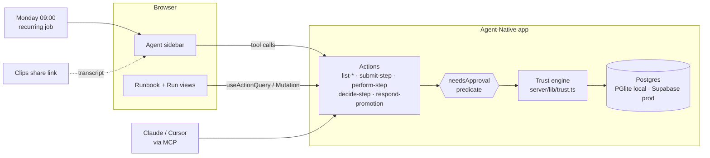
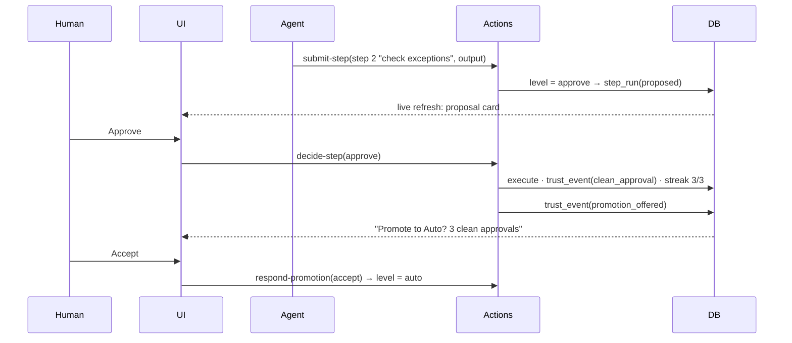

# Understudy — Architecture

> **You don't hand the agent the keys. It earns them, one step at a time.**

## Pitch

Understudy turns a recurring chore you recorded once (a Clip of you doing it, narrated) into a runbook the agent runs with you every week. Every step sits on a trust ladder: **Shadow** (agent suggests, you do it) → **Approve** (agent does it, you sign off) → **Auto** (agent does it and logs it). A step climbs only on evidence: after N clean approvals in a row, the agent *asks* to be promoted. Any correction knocks it back down. Risky steps, like anything that messages a client, are capped at Approve no matter how good the record is. You can see why every step sits where it does, because each level links to the approvals that earned it.

What makes it different: recording-to-agent tools (SkillForge, Zight Agent) hand over the whole workflow at once, and governance platforms (Sagepilot) set autonomy per workflow by admin config. Understudy grants autonomy **per step**, **from the user's own approval history**, and the framework enforces it on every surface.

## Problem

| | |
|---|---|
| **Who** | The founder or ops lead at a 3–15 person agency who chases overdue invoices every Monday morning. |
| **Workaround today** | They open the invoicing tool, filter overdue, cross-check a notes doc for exceptions ("Acme's AP is out until the 10th"), copy-paste a reminder template, adjust the tone per client, send, then log it in a sheet. Dedicated AR tools (Chaser, Upflow) exist, but they want rules configured upfront and then run everything automatically, which is a hard sell when the messages go to your clients. |
| **Cost** | UK Dept for Business & Trade / Small Business Commissioner (2025): businesses affected by late payment spend on average **86 staff-hours a year** chasing it (~1.7 h/week). QuickBooks 2025 US Late Payments Report: **56%** of small businesses are owed money on unpaid invoices, **$17,500** on average. |
| **Evidence** | The two reports above (secondary coverage; primary reports to be linked in the README). *Hypothesis, not yet evidenced:* people avoid automating this because they don't trust an all-or-nothing bot with client relationships. We will state it as a hypothesis. |
| **Sponsor removal test** | Take Agent-Native out and the trust ladder becomes an honour system in a prompt. The level gate is a `needsApproval` predicate on the action, which the framework checks on every caller (agent loop, MCP, HTTP, A2A). Live sync shows the agent's work arriving step by step. The same action powers the UI button and the agent tool. Without these, the agent could just skip the review. |

### Capability map

| User flow | Agent-Native capability | Where |
|---|---|---|
| Agent runs the runbook, step by step | `defineAction` tools + agent chat loop | `actions/submit-step.ts`, `server/plugins/agent-chat.ts` |
| Auto steps run unattended, gated steps can't | `needsApproval: (args) => level(step) !== "auto"`, checked on all surfaces | `actions/perform-step.ts` |
| Human approves / edits / rejects a proposal | UI-only action (`uiOnly: true`), so the agent can't approve itself | `actions/decide-step.ts` |
| Promotion offer → accept / decline | Same pattern: agent proposes in chat, human decides in the UI | `actions/respond-promotion.ts` |
| Run timeline fills in live as the agent works | Live sync (chat-run query invalidation; `useDbSync` for scheduled runs) | `app/routes/runbooks.$id.tsx` |
| "Why is this step on Approve?" while looking at it | Context awareness (`navigation` + `view-screen`) | `app/hooks/use-navigation-state.ts` |
| Runs every Monday 09:00 without you | Recurring job (`jobs/*.md`, cron) | `actions/schedule-runbook.ts` (M3) |
| Runbook drafted from a recorded Clip | Clips share link (transcript + frames) read by the agent | `actions/import-clip.ts` (M2) |
| Claude / Cursor can run the chore from outside | MCP server: same actions, same gate | `mcpTool: true` on actions (M3) |

## System overview

## Data model

All tables carry `owner_email` / `org_id` (`ownableColumns()` for the runbook; children copy the parent's scope).

| Table | Purpose |
|---|---|
| `runbooks` | A chore: title, source clip URL, transcript excerpt, schedule. |
| `runbook_steps` | Ordered steps: title, instruction, `effect` (`note` / `send_emails` / `log` / `escalate`), `risk` (`low` / `high`), `level` (`shadow` / `approve` / `auto`), `streak`, `threshold`, `promotion_offered_at`. |
| `runs` | One execution of a runbook: trigger (`manual` / `schedule`), status (`running` / `waiting` / `done`). |
| `step_runs` | One step inside a run: agent `proposal` JSON, `final` JSON, `status` (`suggested` / `proposed` / `approved` / `edited` / `rejected` / `auto_done` / `human_done` / `corrected`), feedback, decided by/at. |
| `trust_events` | The evidence ledger: `clean_approval`, `edit`, `rejection`, `correction`, `promotion_offered`, `promoted`, `promotion_declined`, `demoted`, with from/to level and a link to the step run. |
| `invoices`, `client_notes`, `outbox` | The mock domain: overdue invoices, per-client exceptions, and a mock inbox standing in for real email. |

### Trust rules (`server/lib/trust.ts`, pure and unit-tested)

- **cap** = `approve` if `risk = high`, else `auto`.
- Approve-level step approved **unchanged** → `streak + 1`. At `streak ≥ threshold` and level below cap → **offer promotion** (never automatic; the human accepts).
- Approve-level step **edited** → `streak = 0`, level stays.
- **Rejected** → `streak = 0`, demote one level (floor `shadow`).
- Auto step **corrected** after the fact → demote to `approve`, `streak = 0`.
- Shadow step: the human does it; if they used the agent's suggestion as-is, that counts as a clean approval toward `approve`.

## Key flows

1. **Monday run.** Agent reads overdue invoices and client notes, then calls `submit-step` for each step. Auto steps execute straight away and are logged. Approve steps land in the run view as proposals. Shadow steps land as suggestions.
2. **Review.** The human approves, edits or rejects inline. `decide-step` executes the final version, writes the evidence and updates the streak. Hitting the threshold raises a promotion offer.
3. **Correction.** The human corrects an Auto step's output. The step drops to Approve, and the ledger shows why.
4. **Gate holds.** Ask the agent to "just send them all now" (or call `perform-step` from Claude over MCP). The framework's approval prompt appears, because the predicate reads the same trust table.

## Stack

- **Agent-Native 0.222.2** (React Router 8 + Vite + Nitro, Drizzle on Postgres). The framework sets this stack, which is why we deviate from the playbook's Next.js default.
- **DB:** PGlite locally (free, embedded); Supabase Postgres (free tier, transaction pooler) for the deployed app. No paid DB.
- **Host:** Vercel Hobby, deployed from the CLI with `pnpm build:vercel`. The template's `netlify.toml` is unused.
- **LLM:** Meta Muse Spark 1.3 through an OpenAI-compatible endpoint, set as deployment env vars so every account can chat.

## Out of scope

- Real email or payments. The send step writes to a mock inbox (`outbox`) and is disclosed as such.
- Arbitrary Clips. One recorded Clip of one chore is supported end to end.
- Multi-tenant teams and roles beyond the template's defaults.
- A runbook editor beyond reordering and editing step text.

## Milestones

| | Done when | Status |
|---|---|---|
| **M1 — Trust ladder end to end** | Seeded runbook with history; agent runs it; approve, edit, reject and correct all move the ladder; promotion offer works; gate blocks `perform-step` above level. Deployed. | Done, live on Vercel |
| **M2 — From a Clip** | The agent reads a Clips share transcript and drafts the runbook steps; the human edits them before saving. | Not built |
| **M3 — Runs without you** | Monday recurring job; MCP exposure with the gate demo from Claude; "Reset & launch demo". | Partly: "Load the demo" and "Reset demo data" are built; MCP is exposed by the framework at `/mcp` but not demonstrated; the recurring job is not built |
| **M4 — Ship** | UI polish pass, `pnpm e2e` evidence, README, demo script, submission text. | Done: 10 unit tests and 1 e2e passing, demo Clip published |
