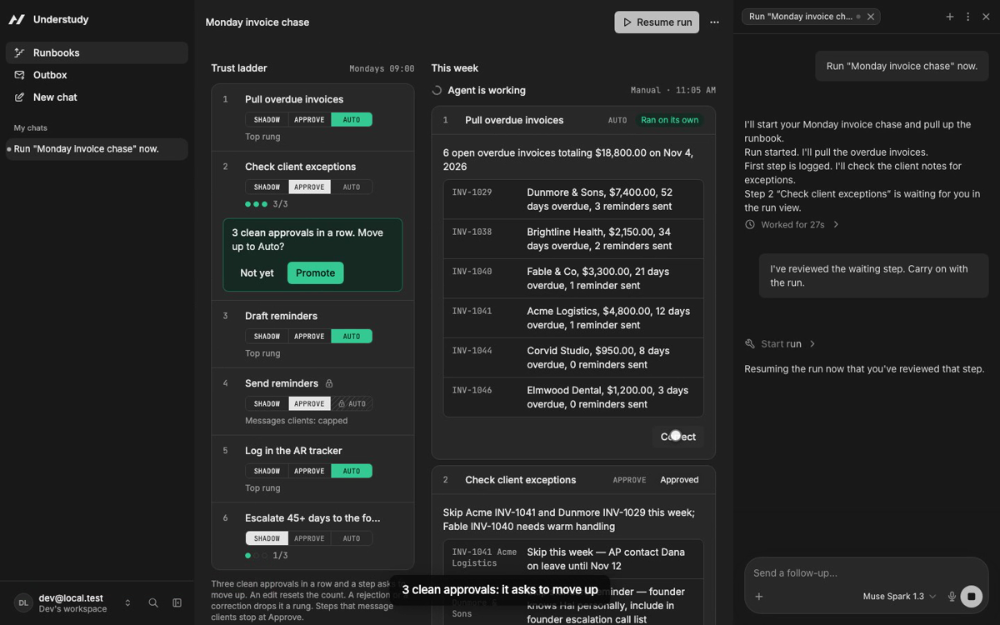
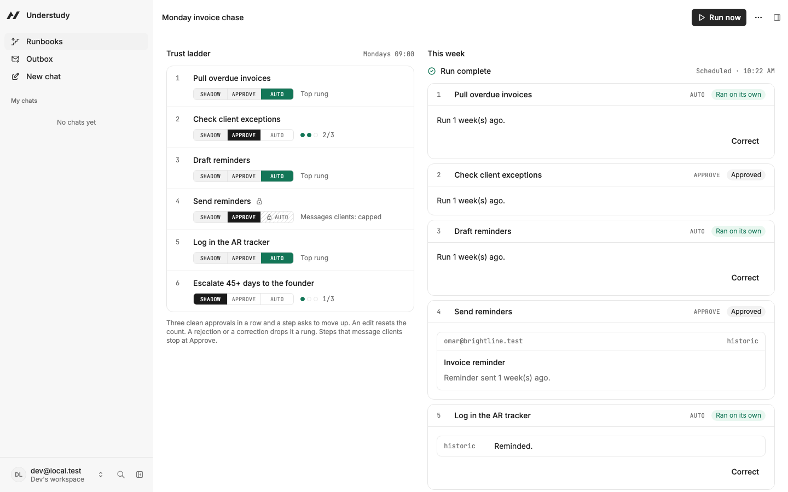
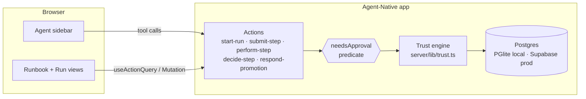
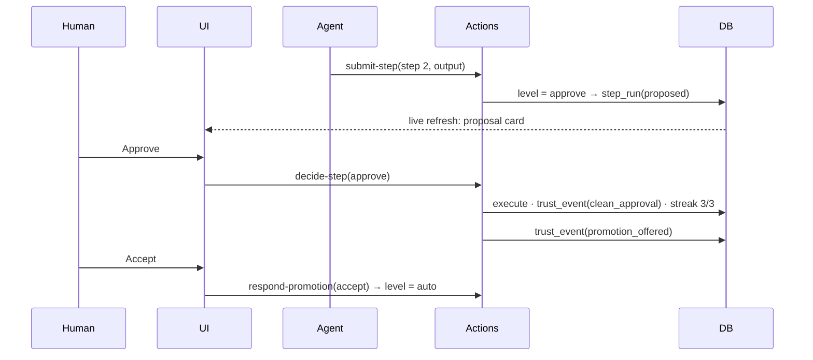

# Understudy


[](https://clips.agent-native.com/share/F0P4iKgswOlJ)

*Click to watch the 2:17 demo.*

### You don't hand the agent the keys. It earns them, one step at a time.

Understudy is for the person who does the same chore every week and wouldn't trust a bot with all of it. The chore becomes a runbook, and each step sits on a trust ladder: **Shadow** (the agent drafts, you do it), **Approve** (the agent does it, you sign off) or **Auto** (it just runs and logs it). After three clean approvals in a row it *asks* to move up. You decide. An edit resets the streak, a reject drops it a rung, and any step that emails a client is capped at Approve, however good its record.

The agent is a real model (Meta Muse Spark 1.3) calling real actions. The only mock is the outbox, which stands in for email.

**[Watch the demo](https://clips.agent-native.com/share/F0P4iKgswOlJ)** · **[Live app](https://understudy-drab.vercel.app)** · [Verify it yourself](#verify-it-yourself-in-60-seconds) · [Architecture](ARCHITECTURE.md) · [Run it locally](#run-it-locally)

## Contents

[Demo](#demo) · [Verify it yourself](#verify-it-yourself-in-60-seconds) · [The problem](#the-problem) · [What it does](#what-it-does) · [Architecture](#architecture) · [The hard problem](#the-hard-problem-signup-that-failed-only-on-the-live-site) · [Real vs simplified](#whats-real-and-whats-simplified) · [Engineering decisions](#engineering-decisions) · [Project layout](#project-layout) · [Run it locally](#run-it-locally) · [Limitations](#known-limitations-and-disclosure)

## Demo

[Public Clip, 2:17](https://clips.agent-native.com/share/F0P4iKgswOlJ), with the full shot list in [docs/demo-script.md](docs/demo-script.md): the Monday invoice chase run twice. First run: step 1 runs on its own, step 2 waits, three clean approvals earn a promotion offer, the send step is capped at Approve, and an edit resets its streak. Second run: the promoted step runs unattended.

Disclosure about the recording:

- It was recorded on a **local build of this same code** with the real Muse Spark model, on a fresh database, because the live database stalled once while I was recording.
- Nothing is sped up. The agent takes 25 to 70 seconds per turn, so those waits are **cut**, and every cut is labelled on screen ("Cut: the agent worked for Ns").
- The narration is a single voice take placed over the footage.



## Verify it yourself in 60 seconds

**On the live site** (no setup, no key):

1. Open [understudy-drab.vercel.app](https://understudy-drab.vercel.app) and create an account.
2. Go to **Runbooks** and press **Load the demo**.
3. Open the runbook, press **Run now**, and leave the model picker on **Muse Spark 1.3**. The agent runs step 1 on its own and stops at step 2, which is on Approve.
4. Press **Approve** on step 2, then **Outbox** in the sidebar.

Do one thing at a time and wait for the agent to go quiet. Clicking while it is mid-run can make it lose its lease on the run ("Execution lease no longer current"). The GPT entries in the model picker are the framework's defaults and fail against Meta's endpoint, so leave it on Muse Spark.

**From the repo** (needs Node 22.22 or newer and pnpm; no model key):

```bash
pnpm install
pnpm test    # 10 passing: trust-ladder rules and usage cap
pnpm e2e     # 1 passing: the whole Monday run against a real Postgres (PGlite)
```

`pnpm e2e` writes [docs/evidence/e2e-latest.txt](docs/evidence/e2e-latest.txt). Its checks, in order:

```
✓ step 1 (Auto) ran unattended
✓ step 2 (Approve) waits for the person; step 3 refused with waiting_on_person
✓ gate: perform-step on an Approve step needs a human (needsApproval predicate = true)
✓ step 2 approved unchanged: streak 3/3, promotion offered (not applied)
✓ person accepted: step 2 promoted Approve → Auto
✓ step 3 (Auto) corrected after the fact: demoted Auto → Approve, streak reset
✓ step 4 (Send, capped) sent the person's edited version to the mock outbox; edit reset its streak
✓ step 6 (Shadow) done by the person with the agent's suggestion: streak 2/3; run done
✓ database CHECK refuses to put a high-risk step on Auto, even with raw SQL
✓ final ladder: auto/auto/approve/approve/auto/shadow
```

## The problem

The founder or ops lead of a small agency chases overdue invoices every Monday. They filter overdue in the invoicing tool, check a notes doc for exceptions ("Acme's AP is out until the 10th"), paste a reminder template, adjust the tone per client, send, and log it. Dedicated AR tools exist, but they want rules set up first and then send everything automatically, which is a hard sell when the messages go to your clients.

What it costs: the UK Department for Business and Trade and the Small Business Commissioner (2025) put the average at **86 staff-hours a year** per business affected by late payment. The QuickBooks 2025 US Late Payments Report found **56%** of small businesses are owed money on unpaid invoices, **$17,500** on average. These come from secondary coverage; I haven't linked the primary reports.

*Hypothesis, not evidenced:* people don't automate this because they won't trust an all-or-nothing bot with client relationships.

Take Agent-Native out and the trust ladder is an honour system in a prompt. Here the level gate is a `needsApproval` predicate on the action, which the framework checks for every caller.

## What it does

| Capability | What you do | Agent-Native pieces behind it |
|---|---|---|
| Agent runs the runbook step by step | Press **Run now**, or ask in chat | `defineAction` tools + agent chat loop: `actions/start-run.ts`, `actions/submit-step.ts` |
| Auto steps run alone, gated steps can't | Nothing | `needsApproval: (args) => level(step) !== "auto"` on `actions/perform-step.ts`, read from the same table as the ladder |
| Approve, edit or reject a proposal | Click | `actions/decide-step.ts` is `uiOnly: true`, so the agent can't approve itself |
| Promotion offer | Accept or decline | `actions/respond-promotion.ts`, also UI-only |
| Timeline fills in live | Watch | Live sync while the chat run streams |
| "Why is this step on Approve?" | Ask the agent | Context awareness (`view-screen`) + `actions/explain-step.ts` |
| Evidence behind every level | Click a step | `trust_events` ledger, shown in the step drawer |

## Architecture





| Table | Role |
|---|---|
| `runbooks`, `runbook_steps` | The chore and its steps, each with `effect`, `risk`, `level`, `streak`, `threshold` |
| `runs`, `step_runs` | One execution, and each step's proposal and final output |
| `trust_events` | The evidence ledger behind every level change |
| `invoices`, `client_notes`, `outbox` | The mock domain. `outbox` stands in for email. |

Trust rules (`server/lib/trust.ts`, pure and unit-tested):

- A step's cap is Approve if its risk is high, otherwise Auto.
- An Approve step approved unchanged adds 1 to its streak. At the threshold and below its cap, it **offers** a promotion. It never promotes itself.
- An edit resets the streak. A reject resets it and drops one level. An Auto step corrected afterwards drops to Approve.
- A Shadow step the person did using the agent's suggestion unchanged counts as a clean approval.

## The hard problem: signup that failed only on the live site

Signup worked on my laptop and failed on Vercel with `write CONNECTION_ENDED`. I spent hours changing one setting at a time (Fluid Compute off, session pooler to transaction pooler, function pinned next to the database). Each change moved the symptom and none fixed it, and a plain connection check passed the whole time.

What found it was running the production build locally with `VERCEL=1` against the same Supabase database and logging every database error. On serverless the framework caps its Postgres pool at **one** connection. A startup query holds that connection while the others queue behind it, each hits the 8-second timeout, and the framework then ends the pool, so every later query fails. It isn't Vercel or Supabase, and it fails the same way on a laptop.

The fix is a post-build script (`scripts/vercel-function-config.mjs`) that raises the serverless pool to 5, pins the function to the database's region and sets `maxDuration`. It throws if the framework code it patches has moved, so an upgrade can't silently undo it. The same repro went from a 500 after 10.7 s to a correct answer in 1.2 s. More in [docs/build-log.md](docs/build-log.md).

## What's real and what's simplified

| Capability | How it's backed | Status |
|---|---|---|
| The agent | Meta Muse Spark 1.3 through an OpenAI-compatible endpoint, tool-calling real actions | Real |
| The approval gate | `needsApproval` predicate checked by the framework; the agent has no approve tool | Real |
| Trust ladder and evidence | Postgres tables; the unit tests and e2e cover each rule, including a database CHECK that keeps high-risk steps off Auto | Real |
| Accounts | Email and password, on Supabase Postgres, deployed on Vercel | Real |
| Sending reminders | Writes to the demo **outbox**. Nothing is emailed. | Simplified on purpose |
| The runbook | **Seeded** by "Load the demo". It is not built from a Clip. | Simplified |
| Importing a Clip into a runbook | Not built | Not built |
| Scheduled Monday run | Not built. Runs start from **Run now** or from chat. The "Mondays 09:00" label on the ladder is the runbook's intended schedule, and nothing triggers it yet. | Not built |
| Running the chore from Claude or Cursor over MCP | The framework serves every action at `https://understudy-drab.vercel.app/mcp` (OAuth sign-in), and the gate is a framework predicate, so it should apply there too. I haven't demonstrated it with a real MCP client. | Exposed, not demonstrated |
| Per-account cost limit | New runs are refused once an account's recorded model spend reaches $5 (about 30 runs). Chat outside runs isn't capped. | Real, partial |

## Engineering decisions

- **The gate is the framework's, not a prompt.** A system prompt is a suggestion and an MCP client never sees it. The predicate reads the same table as the UI.
- **The agent can't approve itself.** `decide-step` and `respond-promotion` are `uiOnly: true`.
- **High-risk steps can't reach Auto**, enforced by the unit tests and by a database CHECK, so raw SQL can't do it either.
- **The model is set on the deployment** (`OPENAI_API_KEY`, `OPENAI_BASE_URL`, `AGENT_MODEL`), so every new account can chat. A provider saved in Settings is per-workspace, and a judge's fresh account had none.
- **`submit-step` is `retrySafe`.** It validates before writing, writes in one transaction and refuses a second submit of the same step, so a bad first call recovers without stopping the run.
- **One run costs about $0.17 to $0.19** on Muse Spark. `AGENT_MAX_ITERATIONS=40` and `AGENT_MAX_RUN_INPUT_TOKENS=1000000` keep a bad run from spending much.

## Project layout

```
actions/      one file per action: the agent's tools and the UI's mutations
app/routes/   runbook list, runbook and run view, outbox, settings
server/lib/   trust.ts (rules), runbook.ts (payload checks), usage-cap.ts, demo.ts (seed)
server/plugins/agent-chat.ts   the agent's system prompt and tool wiring
scripts/      vercel-function-config.mjs (post-build patch), db-check, db-activity
tests/        monday-run.pglite.spec.ts, the end-to-end run
docs/         build-log, demo script, submission text, evidence screenshots and e2e output
public/       icons and web manifest
data/         local PGlite database (gitignored)
```

Some files at the root come from the framework's starter template and aren't specific to Understudy: `DESIGN.md`, `DEVELOPING.md`, `CHANGELOG.md` and `changelog/`, `learnings.md`, and `netlify.toml` (unused; the app deploys to Vercel). The project's own docs are this README, [ARCHITECTURE.md](ARCHITECTURE.md), [AGENTS.md](AGENTS.md) and [docs/](docs/).

## Run it locally

```bash
pnpm install
pnpm dev         # http://localhost:8080, embedded PGlite, "Continue as local dev"
```

The agent needs a model. Set these before `pnpm dev`:

| Variable | Needed | Description |
|---|---|---|
| `OPENAI_API_KEY` | for the agent | Key for any OpenAI-compatible endpoint (I use Meta's) |
| `OPENAI_BASE_URL` | for the agent | Endpoint, for example `https://api.meta.ai/v1` |
| `AGENT_MODEL` | for the agent | Model id, for example `muse-spark-1.3` |
| `AGENT_MAX_ITERATIONS`, `AGENT_MAX_RUN_INPUT_TOKENS` | optional | Caps per run (I use 40 and 1000000) |
| `DATABASE_URL` | production | Postgres URL; leave unset locally to use PGlite |
| `BETTER_AUTH_SECRET` | production | Stable secret for sessions |
| `CRON_SECRET` | Vercel | Required by the framework's cron |

Deploy to Vercel from this folder:

```bash
pnpm build:vercel && npx vercel deploy --prebuilt --prod
```

`build:vercel` sets a daily cron (Vercel Hobby rejects more frequent ones) and runs the post-build patch described above.

## Known limitations and disclosure

- The demo runbook is seeded, and Clip import, a scheduled run and MCP are not built (see the table above).
- The live database stalled once for about 2 minutes during my first recording attempt and recovered by itself. I could not capture the cause. A snapshot taken afterwards showed no locks and no stuck transactions.
- One overlapping click can still queue a duplicate "carry on" message in the agent chat, which the framework answers with a 409. It's harmless but visible.
- Built for the Builder.io Agent-Native Hackathon (deadline 9 Nov 2026). It starts from the Agent-Native "Chat" starter template (the framework's own app scaffold). The first commit of this project was on 2 Nov 2026.
- The late-payment figures above are from secondary coverage and aren't independently verified.
